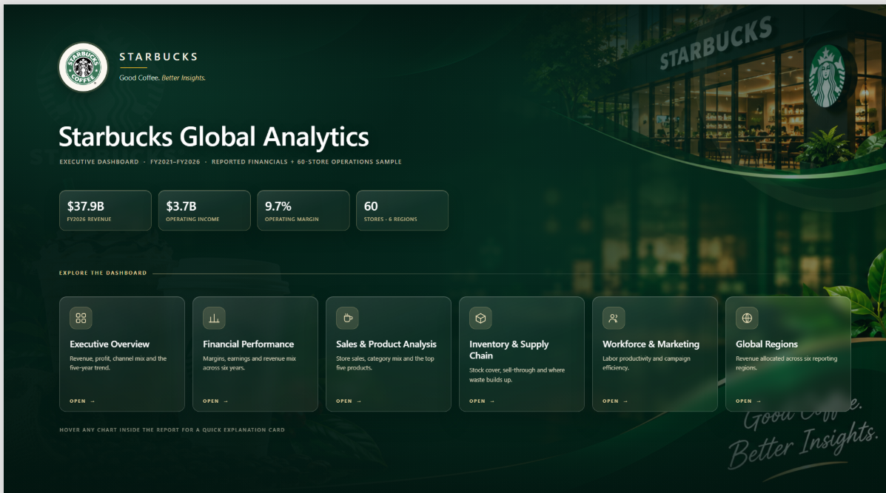
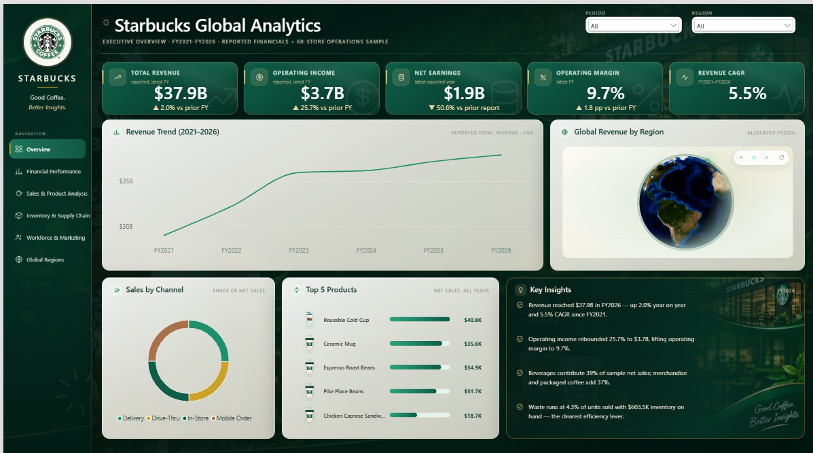
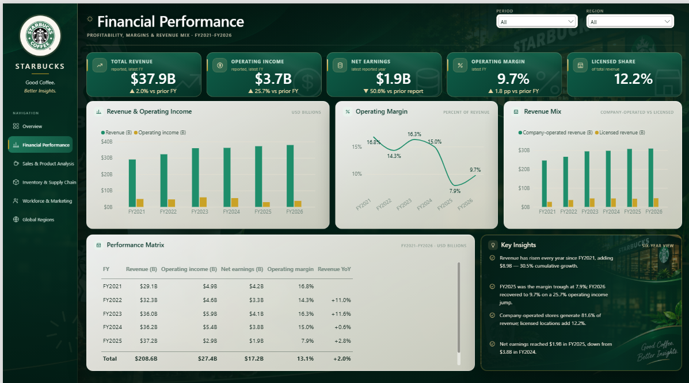
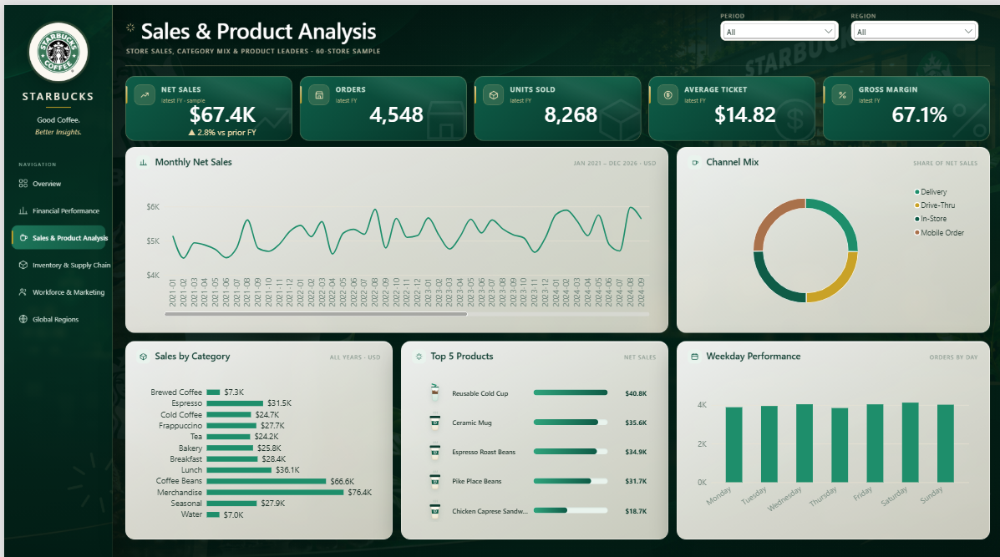
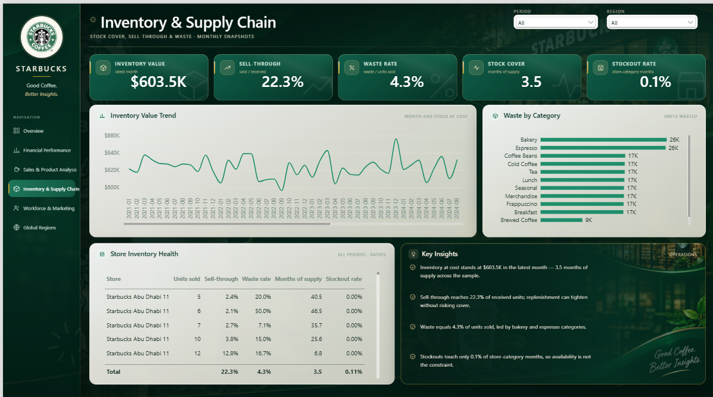
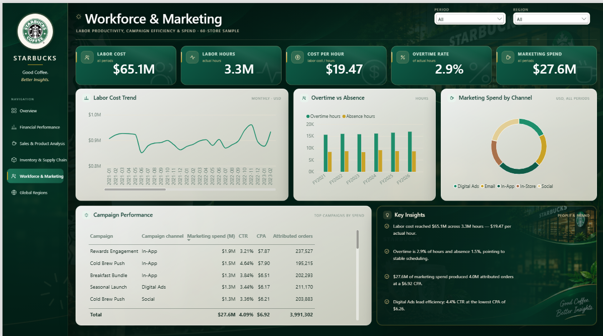
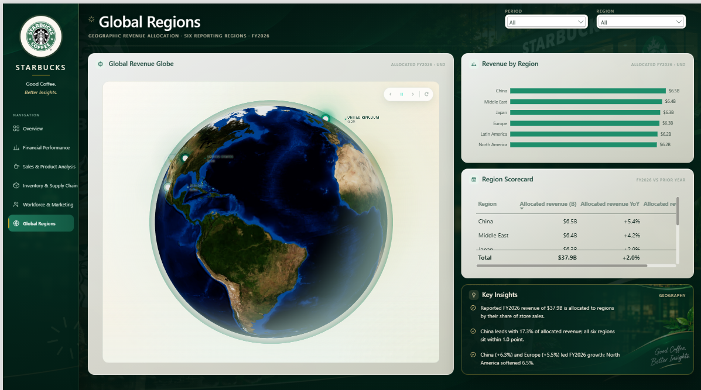

# Starbucks Global Analytics (FY2021 - FY2026)

A seven-page executive Power BI report that pairs Starbucks' reported consolidated financials with a 60-store operations sample, so financial performance, retail execution and regional allocation can be read in one place.



## Overview

| Item | Detail |
|---|---|
| Period | FY2021 - FY2026 |
| Tooling | Power BI Desktop, DAX, Power Query, TypeScript custom visuals, PBIP |
| Financial data | Reported consolidated annual results (revenue, operating income, net earnings, margins) |
| Operations data | Synthetic 60-store sample across six reporting regions (sales, inventory, labour, marketing) |
| Report format | Power BI Project (`.pbip`) with PBIR visuals and TMDL model files |
| Pages | 7, including a landing page with navigation tiles |

## Pages

| Page | What it covers |
|---|---|
| Home | Landing page with four headline KPIs and six navigation tiles into the report |
| Overview | Five KPI cards, six-year revenue trend, revenue by region globe, channel mix, top products, key insights |
| Financial Performance | Revenue, operating income and earnings cards, revenue vs operating income by year, operating margin trend, company-operated vs licensed mix, full performance matrix |
| Sales & Product Analysis | Net sales, orders, units sold, average ticket and gross margin; monthly net sales from Jan 2021 to Dec 2026; channel mix; category sales; top five products; weekday performance |
| Inventory & Supply Chain | Inventory value, sell-through, waste rate, months of supply and stockout rate; inventory value trend; waste by category; store inventory health table |
| Workforce & Marketing | Labour cost and hours, cost per hour, overtime rate and marketing spend; labour cost trend; overtime vs absence; marketing spend by channel; campaign performance table |
| Global Regions | 3D revenue globe, allocated revenue by region and an FY2026 region scorecard |

Each content page carries a **Key Insights** panel and every chart has a hover explanation card that states what the chart shows and what the takeaway is.

## Screens

| Overview | Financial Performance |
|---|---|
|  |  |

| Sales & Product Analysis | Inventory & Supply Chain |
|---|---|
|  |  |

| Workforce & Marketing | Global Regions |
|---|---|
|  |  |

## Semantic model

A star schema feeds every page:

| Type | Tables |
|---|---|
| Dimensions | `Dim_Date`, `Dim_Year`, `Dim_Store`, `Dim_Product`, `Dim_Category`, `Dim_Customer`, `Dim_Region` |
| Facts | `Fact_Financials`, `Fact_Sales`, `Fact_Inventory`, `Fact_Labor`, `Fact_Marketing` |

Relationships keep the financials grain separate from the store-level operations grain, so margins are never double counted when operational filters are applied.

Each KPI and ratio has a defined measure in the model (for example operating margin, revenue CAGR, sell-through, waste rate, months of supply, cost per labour hour, CTR, CPA and attributed orders).

## Chart explanation cards

Power BI's built-in tooltip pages did not render reliably in the Desktop build used here, so the explanations are delivered as DAX measures named `About · <chart name>` and bound to each visual's tooltip role. Hovering a chart shows its own name plus the measure text, which keeps the explanation inside the report and out of the visual's title area.

## Custom visuals

| Visual | Purpose |
|---|---|
| Starbucks Global Globe | Interactive 3D globe with day/night Earth, market markers and region highlighting; cross-filters the regional charts |
| Starbucks Cup Ranking | Animated product ranking with illustrated cup icons, bars and values |

Both visuals are TypeScript developments packaged inside `Starbucks_Global_Analytics.Report/CustomVisuals`, so the report opens without installing anything from AppSource.

## Design

The report uses a Starbucks palette theme (`StarbucksLight.json`), a glassmorphism card style, per-page background artwork registered as report resources, and a fixed navigation rail that mirrors the six content pages. The layout is authored for a 16:9 canvas with large KPI numerals so the numbers stay readable in a presentation.

## Repository contents

```text
starbucks-global-analytics/
|-- Starbucks Global Analytics.pbip
|-- Starbucks_Global_Analytics.Report/          # PBIR pages, theme, backgrounds, custom visuals
|-- Starbucks_Global_Analytics.SemanticModel/   # TMDL model: tables, relationships, DAX measures
|-- assets/                                     # page screenshots used above
|-- data/
|   `-- Starbucks_Analytics_Dataset_2021_2026.xlsx
`-- README.md
```

## Opening the report

1. Install Power BI Desktop (the PBIP feature is on by default in current builds).
2. Open `Starbucks Global Analytics.pbip`.
3. The model ships with its data imported, so pages render without a refresh.

## Data notes

Financial figures come from Starbucks' reported annual results for FY2021 - FY2026. The operational tables (store sales, inventory, labour, marketing campaigns) are a synthetic sample built for portfolio practice, and are labelled as such on the report's pages; they are not Starbucks internal data.
